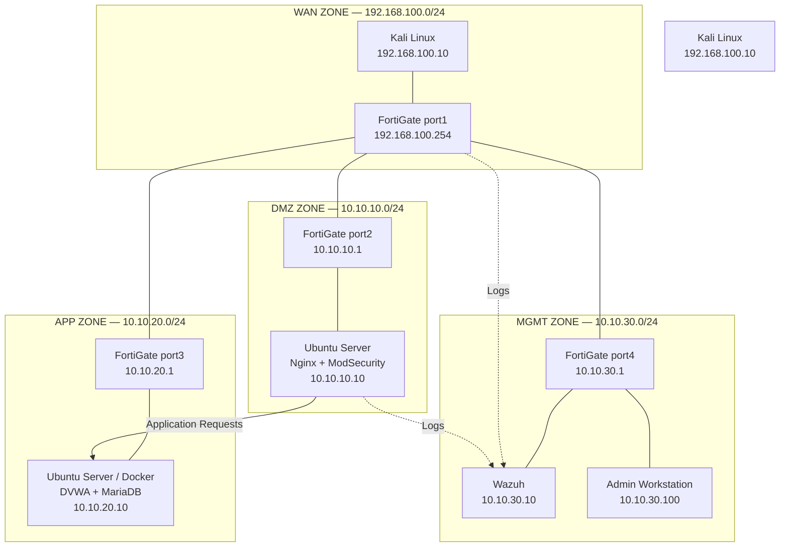

## Logical Architecture

## Addressing Plan

| Zone | Network | Device | Interface | IP Address |
|---|---|---|---|---|
| WAN | 192.168.100.0/24 | Kali Linux | NIC 1 | 192.168.100.10 |
| WAN | 192.168.100.0/24 | FortiGate-VM | port1 | 192.168.100.254 |
| DMZ | 10.10.10.0/24 | FortiGate-VM | port2 | 10.10.10.1 |
| DMZ | 10.10.10.0/24 | WAF Server | NIC 1 | 10.10.10.10 |
| APP | 10.10.20.0/24 | FortiGate-VM | port3 | 10.10.20.1 |
| APP | 10.10.20.0/24 | DVWA + MariaDB Server | NIC 1 | 10.10.20.10 |
| MGMT | 10.10.30.0/24 | FortiGate-VM | port4 | 10.10.30.1 |
| MGMT | 10.10.30.0/24 | Wazuh | NIC 1 | 10.10.30.10 |
| MGMT | 10.10.30.0/24 | Admin Workstation | NIC 1 | 10.10.30.100 |

## Segmentation Principles

- Each zone uses a separate isolated virtual network.
- The four FortiGate interfaces connect the zones and provide inter-zone routing.
- The DVWA server is located in the APP zone and must not be directly exposed to the WAN.
- The WAF server is located in the DMZ and acts as the frontend for DVWA.
- Wazuh and the admin workstation are located in the MGMT zone.
- The subnets do not overlap.

## Items to Confirm Before Validation

- The exact names of the virtual networks in VMware or VirtualBox.
- The static addressing method for the VM interfaces.
- The default gateway for Kali and the internal servers: the FortiGate address for their zone is proposed as the gateway.
