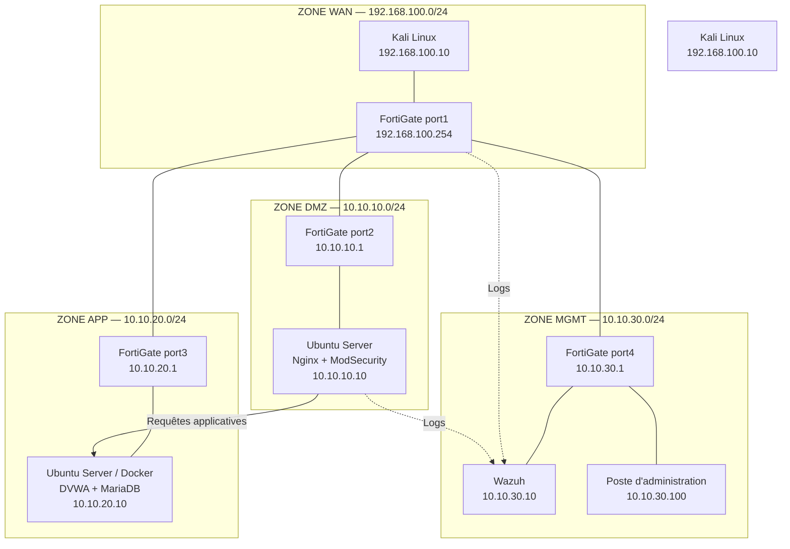

## Architecture logique

## Plan d’adressage

| Zone | Réseau | Équipement | Interface | Adresse IP |
|---|---|---|---|---|
| WAN | 192.168.100.0/24 | Kali Linux | NIC 1 | 192.168.100.10 |
| WAN | 192.168.100.0/24 | FortiGate-VM | port1 | 192.168.100.254 |
| DMZ | 10.10.10.0/24 | FortiGate-VM | port2 | 10.10.10.1 |
| DMZ | 10.10.10.0/24 | Serveur WAF | NIC 1 | 10.10.10.10 |
| APP | 10.10.20.0/24 | FortiGate-VM | port3 | 10.10.20.1 |
| APP | 10.10.20.0/24 | Serveur DVWA + MariaDB | NIC 1 | 10.10.20.10 |
| MGMT | 10.10.30.0/24 | FortiGate-VM | port4 | 10.10.30.1 |
| MGMT | 10.10.30.0/24 | Wazuh | NIC 1 | 10.10.30.10 |
| MGMT | 10.10.30.0/24 | Poste d'administration | NIC 1 | 10.10.30.100 |

## Principes de segmentation

- Chaque zone utilise un réseau virtuel isolé distinct.
- Les quatre interfaces du FortiGate relient les zones et assurent le routage inter-zone.
- Le serveur DVWA est placé dans la zone APP et ne doit pas être directement exposé au WAN.
- Le serveur WAF est placé dans la DMZ et sert de frontal à DVWA.
- Wazuh et le poste d'administration sont placés dans la zone MGMT.
- Les sous-réseaux ne se chevauchent pas.

## Points à confirmer avant validation

- Le nom exact des réseaux virtuels dans VMware ou VirtualBox.
- Le mode d'adressage statique des interfaces des VM.
- La passerelle par défaut de Kali et des serveurs internes : l'adresse FortiGate de leur zone est proposée comme passerelle.

